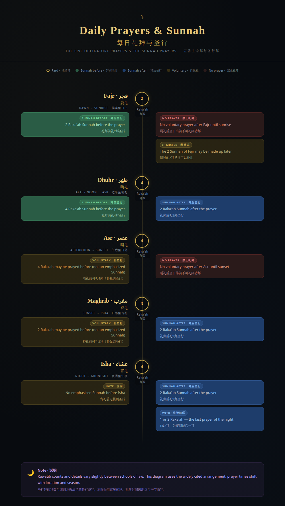

# Daily Prayers & Sunnah · 每日礼拜与圣行

A single-file, bilingual (English / 中文) diagram of the five daily prayers: the raka'ah count of each fard prayer, the Sunnah (Rawatib) prayed before and after, and the times when voluntary prayer is prohibited.

**Live page:** <https://muhammad-wei.github.io/prayers-diagram-bilingual/>



## What it shows

- The five obligatory prayers with their Arabic and Chinese names and time windows.
- Sunnah before and after each prayer, colour-coded.
- The windows after Fajr and after Asr when voluntary prayer is prohibited.
- The ruling on the missed Sunnah of Fajr and a short note on Witr.
- A responsive layout for desktop and mobile, with reduced-motion support.

## Notes

- Rawatib counts and details vary slightly between schools of law. This diagram uses the widely cited arrangement; for worship, follow your own school and local scholars.
- Prayer times shift with location and season.
- Fonts load from Google Fonts (Amiri, Lato, Noto Serif SC) with local fallbacks, so the page remains readable offline.

## Use

Open `index.html` directly in a browser, or serve the folder:

```sh
python3 -m http.server
```

## Sources

- [Irsyad al-Fatwa Series 113 — Is there a Sunnah prayer before Maghrib?](https://www.muftiwp.gov.my/en/artikel/irsyad-fatwa/irsyad-fatwa-umum-cat/1260-irsyad-al-fatwa-series-113-is-there-sunnah-prayer-before-maghrib-prayer) (Mufti of the Federal Territory, Malaysia; cites Sahih al-Bukhari 1183 and Sahih Muslim 837).
- [Islamweb fatwa 366454 — Praying the Sunnah of Fajr after sunrise](https://islamweb.net/en/fatwa/366454/praying-sunnah-of-fajr-after-sunrise-at-time-of-dislike).
- [Islamweb fatwa 108251 — The supererogatory prayers according to the Hanafi school](https://islamweb.net/en/fatwa/108251/) (illustrates how the counts differ between schools).
